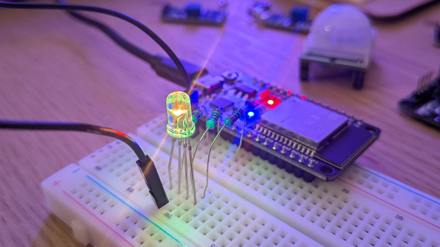
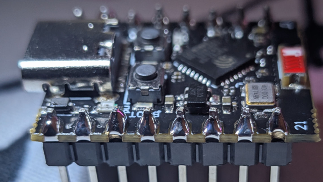
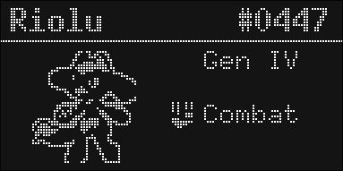

+++
title = "Electronical adventures"
description = "discovery and experiments with electronics"

date = 2026-11-01
+++

Hi, it's been a while! I didn't want to make this post just yet, but the one I
had in mind is taking way longer than expected, so here we are :)

## Down the Rabbit Hole

I'm not entirely sure when I started getting interested in this, but it probably
started with some usual scrolling on twitter. I stumbled onto some tweets from
[@i2cjak](https://x.com/i2cjak) talking about his custom modules for the
Framework laptops and got hooked quite rapidly. The idea of doing something that
would not just appear on your screen, something that would yield a _real_,
_physical_ object was very appealing to me after spending quite a bit of time
learning NixOS and Rust and everything.

I often think about learning more about the how computer works under the hood.
Now that I really understand the hardware, I sometimes wonder about how the
kernel works, and how someone would code on a CPU or on the random devices I own
(be it a Wii remote, a Nintendo DS, or simply a microwave). I think electronics
is a way to get to do stuff like that, while keeping it quite simple. Instead of
designing your own kernel, why not just learn how a micro-processor works?

## Starting up

At the end of July, I finally picked up my first components. I bought an ESP32
Starter Kit, which contained the classic breadboard, a 0.96" OLED screen, and a
mix of wires, buzzers, and random sensors.

<figure>
    
    <figcaption>One of my first circuits, with an rgb led controlled over wifi</figcaption>
</figure>

I then spent around a month with the tutorial pdf, learning how every sensor I
had worked, doing some experiments with active buzzers, i2c, and coding a small
simon game. If you ever want to check out the code, it's available here:
[@luuumine/esp](https://git.luuumine.com/luuumine/esp).

## Dropping the breadboard

Eventually, jumper wires were not enough. I bought smaller hook-up wires,
allowig my projects to not take every space on my desk. I also got a small
soldering iron and a few perfboards to try and solder stuff. After buying more
components from AliExpress (thanks France for the 3€ tax on every product, more
than doubling the cost of components) and trying out my iron on some resistors
on a perfboard, I decided that I wasn't going to learn until I did real stuff,
with something at stake, so I soldered some pins on an ESP32-c3-mini that I got.
Honestly, this wasn't that hard, and I got the hang of it pretty quickly.

<figure>
    
    <figcaption>The successful solder attempt</figcaption>
</figure>

Right now, I'm putting all of this to use by building a custom Pokedex-like
device for a gift. It's been a massive learning curve, but I learnt how a lot of
cool components (LiPo batteries, TP4056 charging module, EC11 rotary encoder,
..) worked, so I'm pretty happy with it so far.

As this project is not finished (yet!), I can't really share more than that for
now, but I'll be sure to update this article when I finish it! In the meantime,
here's a quick sneak peek:

<figure>
    
    <figcaption>One of the Pokedex info screens</figcaption>
</figure>

Here's to hoping I don't burn myself (or my home) while soldering stuff; see
you!
